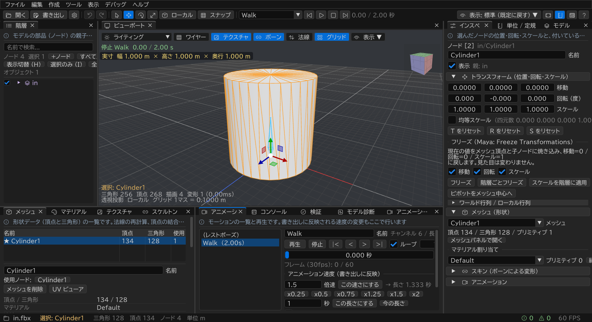

# ModelEditor

Dear ImGui + C++20 で作った 3D モデルエディターです。FBX / glTF / GLB などを読み込み、フリーズ・ボーン確認・マテリアル/テクスチャ編集・単位と実寸の確認・検証を行い、glTF / GLB / FBX などに書き出せます。



## できること

- **約 70 種類の形式を開く** (FBX / glTF / VRM / Blend / X / 3MF / PMX など) → **glTF / FBX / OBJ / 3MF などに書き出す**
- **実寸の確認と定規**: 「高さ 170 cm にする」「2 倍にする」「定規の高さに合わせる」を、位置をずらさずに行う
- **アニメーション付きモデルもずれずに拡大**: ルートモーションごと、エンジンで親を拡大したのと同じように拡大して書き出す
- **アニメーション**: 再生、速度の変更 (x2 / 秒数指定)、別ファイルのモーションの取り込み、インプレース化
- **Maya 風の編集**: フリーズ、スケールの階層への適用、単位・軸の変換、複数選択での同時編集
- **モデルの問題を見つける**: 穴・裏返った面・法線・ウェイト・回転キーの反転・頂点の飛びなどを自動で検出して修正、クリックした頂点の詳細表示、エンジン向けチェック
- **マテリアル・テクスチャ・メッシュ・ウェイトの修正**、コマンドラインでの一括変換

やりたいこと別の詳しい説明は **[できること一覧 (FEATURES.md)](FEATURES.md)** にあります。

## 起動方法

**`bin\ModelEditor.exe` をダブルクリック**するだけです。インストールは不要です。

- `bin\ModelEditor.exe` … エディター本体 (GUI)
- `bin\ModelEditorCli.exe` … コマンドライン版 (一括変換・検証・自己テスト)

`bin` フォルダごとコピーすれば、どの PC でも動きます。GitHub の「Download ZIP」でダウンロードした場合も、`bin\ModelEditor.exe` はそのまま使えます。

### どの PC でも安定して開くための対策
| 対策 | 内容 |
|---|---|
| 追加インストール不要 | C++ ランタイムを静的リンクしています (VC++ 再頒布パッケージ不要)。依存する DLL はすべて Windows 標準のものです |
| GPU が無くても動く | 描画は Direct3D 11 です。GPU やドライバーが使えない環境 (仮想マシン、リモートデスクトップ、古い PC) では自動的に WARP (ソフトウェア描画) で起動します |
| GPU が落ちても復帰 | ドライバー更新やタイムアウトでデバイスが失われた場合は、自動で作り直して続行します |
| 書き込み権限 | 設定・ログは `%APPDATA%\ModelEditor` に保存するので、`Program Files` などに置いても動きます |
| クラッシュ時 | エラーを表示し、`%APPDATA%\ModelEditor\crash_*.dmp` にダンプを保存します |
| 高 DPI | モニターごとの DPI に合わせて UI を拡大します (環境設定で倍率を変更可) |

動作環境: Windows 10 / 11 (64bit)。

## ビルド方法 (CMake 不要)

> **Git LFS が必要です**: `third_party\assimp\lib\assimp.lib` (約 310 MB) は Git LFS で管理しています。
> [Git LFS](https://git-lfs.com/) を入れてから `git clone` してください (入れずに clone した場合は、後から `git lfs pull`)。
> 「Download ZIP」で取得したものには LFS のファイルが含まれないため、ソースからはビルドできません。

1. Visual Studio 2022 (「C++ によるデスクトップ開発」) で **`ModelEditor.sln`** を開く
2. 構成を **Release | x64** にしてビルド (F7)
3. `bin\ModelEditor.exe` が作られます (Debug 構成は `bin\Debug\` に出力)

依存ライブラリはすべて `third_party\` に同梱しているので、clone した後はインターネット接続や追加ツールは不要です。

| ライブラリ | 用途 | 同梱形態 |
|---|---|---|
| Dear ImGui 1.91.9b (docking) | UI | ソース |
| ImGuizmo | ギズモ / ビューキューブ | ソース |
| tinygltf 2.9.6 (+ stb_image) | glTF 書き出し / 検証 | ソース |
| glm 1.0.1 | 数学 | ヘッダー |
| Assimp 6.0.2 | FBX / Blend / X / 3MF 等の読み込み (IFC / USD 以外の全形式)、FBX / OBJ / DAE / X / 3MF / 3DS 等の書き出し | ビルド済み静的ライブラリ (/MT) |

Assimp を更新したいときだけ `tools\rebuild_assimp.bat` を使います (通常は不要です。git と CMake が必要)。

## 主な機能

### 入出力
- **読み込み**: FBX, glTF, GLB, VRM, OBJ, Blend, DAE, 3DS, X, 3MF, PLY, STL, BVH (モーション) など、Assimp が読める形式すべて (IFC / USD 以外。ドラッグ&ドロップ可、別スレッドで読み込み)。一覧は `ModelEditorCli.exe --formats` で確認できます
  - FBX の単位 (UnitScaleFactor) と上方向軸 (UpAxis) を自動で変換し、埋め込みテクスチャの展開や外部テクスチャの自動探索も行います
  - 読み込みモード: 置き換え / シーンに追加 / **アニメーションのみ取り込み** (ノード名で対応付け、`mixamorig:` などの名前空間違いにも対応)
- **書き出し**: GLB / glTF / FBX (バイナリ・ASCII、単位 m / cm) / OBJ / DAE / STL / PLY / X (DirectX) / 3MF / 3DS。glTF は書き出し後に再読み込みして検証します

### 複数オブジェクト / 表示・非表示
- **複数のオブジェクトを並べて扱える**: モデルファイルを複数まとめてドラッグ&ドロップすると、順番に読み込んで追加します。追加したファイルは、ファイル名のグループとして 1 つのオブジェクトになります (ドロップ時の動作はインポート設定で変更可)
- **基本形状**: 「作成 > 基本形状」または階層パネルの「+形状」から、Cube / Sphere / Cylinder / Cone / Plane (1 m) を作成できます
- **表示・非表示**: 階層パネルのチェック、`H` (選択の表示切替)、`Ctrl+H` (非表示)、`Shift+H` (すべて表示)、`I` (選択のみ表示) で切り替えます。選択中のノードのチェックを切り替えると、選択全体に適用されます

### 複数選択と同時編集
- **選択**: ビューポートで左ドラッグすると矩形選択 (Maya と同じ) になります。`Shift` で追加、`Ctrl` で切替です。階層パネルでも Ctrl / Shift で複数選択できます
- **同時編集**: インスペクターで移動・回転・スケールの成分を変えると、選択中の全オブジェクトにその値を設定します。「相対で適用」をオンにすると、変更量を全員に加えます (スケールは倍率)。値が揃っていない成分には「混在」と表示します
- リセット、フリーズ、表示切替、ピボット中心化も、選択全体に適用されます

### 床グリッド
- Maya と同じく、モデルの大きさやアニメーションに関係なく固定のサイズです (既定は 1 マス 10 cm、太線 1 m、範囲 ±10 m)。ビューポートの「表示...」から変更でき、左下に「グリッド 1マス = …」と表示します

### 単位・実寸・定規 (「単位 / 定規」パネル)
- **モデルの長さの単位を表示**: ファイルに記録された単位 (FBX なら UnitScaleFactor から判定) と、現在どの単位として解釈しているかを表示します
- **単位を変更**: 「このモデルの単位」を mm / cm / m / inch / ft から選び直すと、その単位で作られていたものとして実寸を再計算します (Undo 可)
- **実際のサイズを表示**: 幅・高さ・奥行・対角・最低点・最高点を表示単位で表示します。ビューポート左上にも常に実寸を表示し、「人の身長に対して何 %」という目安も出します。アニメーション中でも値が揺れないよう、レストポーズを基準にしています
- **指定サイズにリサイズ**: 例として「高さを 170 cm にする」と指定すると、シーン全体を拡大・縮小します
- **定規**: ワイヤーフレームの枠 2 枚 (原点の面と高さの面)、目盛り、高さのラベルで構成されます
  - 原点は数値入力、ビューポートのギズモ、ボタン (ワールド原点 / モデルの足元 / モデルの横 / 選択ノード / 地面) で自由に動かせます
  - 高さは表示単位で指定でき、**マイナスにも対応**しています (原点より下に伸びます)。「モデル上端まで」「反転 (±)」「1.7 m」などのボタンもあります
  - ラベルにモデル上端 (マイナスなら下端) との差を表示します。定規は複数作成でき、色や最前面表示も変更できます
  - **選択モデルを定規の高さに合わせる**: 選んだオブジェクトを定規の高さまで拡大・縮小します。**頂点には焼き込まず、トランスフォームのスケール値を変更する**ので、スケールは例えば 1.8, 1.8, 1.8 のようになります。足元を定規の原点に合わせる (XZ も合わせる) こともでき、マイナスの定規では上端を原点に合わせます。スキンメッシュを選んだ場合はスケルトンのルートも一緒に拡大します。大きさは全頂点・レストポーズで測るので、アニメーションのどのフレームで実行しても同じ位置に合います
- **指定サイズにリサイズ** も、選択中 (未選択なら全オブジェクト) のトランスフォームのスケールで変更します
- **倍率で拡大縮小**: 「x2」「x0.5」のように倍率を指定して拡大縮小できます (足元の中心は動きません)
- **サイズを変えても XZ は動かない**: 定規フィット・指定サイズ・倍率・インスペクターのスケール・スケールギズモ・S のリセットのあと、オブジェクトの足元の中心 (XZ) を、最初にサイズを変える前の位置に戻します。何度サイズを変えても同じ位置に残ります。移動ツールなどで動かしたときや、定規に「XZ も合わせる」で合わせたときは、その位置が新しい基準になります

### オブジェクトノード (親でスケール、エンジンの GameObject と同じ)
- アニメーション付きのノード (ルートモーションを持つルートボーンなど) を拡大するときは、そのノードではなく、**アニメーションを持たない親 (オブジェクトノード、階層では ▣)** のスケールを変えます。親が無ければ `<名前>_Object` を自動で作ります。ルートモーションも含めて全キーが同じ倍率になるので、エンジンで親を拡大したのと同じく動きがずれません
- 対象: 定規フィット、指定サイズにリサイズ、インスペクターのスケール (「スケール (親)」と表示)、スケールギズモ。ボーン階層の途中のボーンは、従来どおりそのボーン自身のスケールとして扱います
- 書き出し (エクスポート設定の「オブジェクトのスケール」):
  - **中身に焼き込む** (既定): 親の倍率を、ボーン位置・全アニメーションの移動キー・頂点・逆バインド行列に変換し、親のスケールを 1 にします。自動作成した親は書き出しません。書き出し前後で全フレームのボーンと頂点の位置を比較し、結果をログに出します
  - **スケール付きの親ノードとして残す**: 親ノードごと書き出します
  - 非均等スケール (X/Y/Z が違う) の親は焼き込めないため、警告を出して親ノードのまま書き出します
- 階層の右クリックメニュー: 「オブジェクトとして扱う」「オブジェクト用の親ノードを作成」
- 自己テスト: `ModelEditorCli.exe --selftest @rig` で、ルートモーション付きの内蔵リグを使って確認できます

### トランスフォーム (Maya 風)
- **フリーズ (Freeze Transformations)**: 移動・回転・スケールを頂点と子ノードに焼き込み、値を 0 / 0 / 1 に戻します。見た目は変わりません
- **スケールを階層に適用**: リグのルートに付いた 0.01 や 100 のスケールを、ボーン・逆バインド行列・アニメーションまで補正して 1 にします
- ピボットをメッシュ中心へ、リセット、cm↔m 変換、Z-up↔Y-up 変換、原点へ移動、接地。ギズモ (W/E/R)、スナップ

### その他
- 階層 (検索、ドラッグ&ドロップでの親子付け、表示・非表示、リネーム、複製、グループ化) とインスペクター
- ボーン一覧、ウェイトのヒートマップ、ウェイトの正規化と除去、名前空間の除去、一括リネーム
- PBR マテリアルの編集、5 つのテクスチャスロット (ドラッグ&ドロップでの割り当て)、テクスチャの置き換え・保存・再リンク、UV ビューア
- メッシュツール (法線の再計算、反転、接線の生成、頂点の結合、縮退三角形の削除)
- アニメーション (再生、スクラブ、プレビュー速度、インプレース化、キー最適化)
  - **アニメーション速度**: 「x2 で 2 倍速」のように倍率で、または長さ (秒) を指定して、アニメーションの速さを変えます。キーの時刻を変えるので書き出しにも反映されます (全アニメーションにまとめて適用も可)。CLI では `--anim-speed 2`
- デバッグ (検証と自動修正、13 種類の表示モード、法線・接線・AABB の表示、統計、GPU 情報、コンソール、Undo 履歴、シーンダンプ)
  - **モデル診断パネル**: 穴・非多様体・裏返り・法線の裏返り・重なった面などのメッシュ診断、回転キーの反転・ループの継ぎ目・頂点の飛び・ルートモーションなどのアニメーション診断、ジョイントごとのウェイト頂点数、クリックした頂点の詳細、エンジン向けチェック
  - **表示モード**: 裏面 (赤)、法線と面の向き、ウェイト数。**診断の線**: 開いた辺、非多様体の辺、ルートモーションの軌跡、ピボット
  - 詳しくは [できること一覧](FEATURES.md#8-問題がないか確認する)

## 操作方法

| 操作 | キー / マウス |
|---|---|
| 選択 / 矩形選択 | 左クリック / 左ドラッグ (Ctrl: 切替 / Shift: 追加) |
| 回転 / パン / ズーム | Alt+左ドラッグ or 右ドラッグ / 中ドラッグ / ホイール |
| 表示切替 / 非表示 / すべて表示 / 選択のみ表示 | H / Ctrl+H / Shift+H / I |
| 選択を表示 / 全体表示 | F / A |
| 移動 / 回転 / スケール / 選択 | W / E / R / Q (Ctrl でスナップ、X でローカル/ワールド切替) |
| Undo / Redo | Ctrl+Z / Ctrl+Y |
| 開く / 書き出し / 名前を付けて書き出し | Ctrl+O / Ctrl+S / Ctrl+Shift+S |
| 操作方法の一覧 | F1 |

## コマンドライン (`bin\ModelEditorCli.exe`)

```bat
ModelEditorCli.exe --convert in.fbx out.glb --apply-root-scale --fix
ModelEditorCli.exe --validate in.fbx
ModelEditorCli.exe --dump in.glb
ModelEditorCli.exe --selftest in.fbx
```

GUI 版のデバッグ用オプション:

```bat
ModelEditor.exe in.fbx --smoketest
ModelEditor.exe in.fbx --warp
ModelEditor.exe in.fbx --screenshot shot.png --frames 120 --ruler 1.7
```

`--smoketest` は全パネル・全操作を自動で実行して確認します。`--warp` はソフトウェア描画を強制します。`--screenshot` は N フレーム後に画面を保存して終了します。

## トラブルシューティング
- **画面が真っ黒・表示がおかしい**: `ModelEditor.exe --warp` で起動して、ソフトウェア描画で表示されるか確認してください
- **レイアウトが崩れた**: メニューの「表示 > レイアウトをリセット」を使うか、`%APPDATA%\ModelEditor\ModelEditor_imgui.ini` を削除してください
- **不具合報告**: `%APPDATA%\ModelEditor\` 内の `ModelEditor_log.txt` (と `crash_*.dmp`) を添付してください

## ソース構成
```
ModelEditor.sln
projects/            vcxproj (Core: 共通ライブラリ / ModelEditor: GUI / ModelEditorCli: CLI) と共通設定 props
src/core/            シーン (glTF 準拠)、編集オペレーション、検証、診断 (トポロジー・アニメーション・レイキャスト)、Undo、単位
src/io/              Assimp 読み込み、glTF 書き出し、Assimp 書き出し、画像入出力
src/render/          Direct3D 11 レンダラー (HLSL、CPU スキニング、MSAA、ピッキング)
src/editor/          エディターと各パネル (Viewport / Scene / Assets / Anim / Measure / Debug)
src/app/             CLI、自己テスト、シーンダンプ
src/util/            UTF-8 パス対応のファイル操作、ダイアログ、クラッシュハンドラー
third_party/         同梱ライブラリ
tools/               Assimp 再ビルド用スクリプト (通常は不要)
```

## 制限事項
- モーフターゲットのウェイトアニメーションは読み込みません (モーフターゲット自体は扱えます)
- 1 頂点あたりのボーン影響は 4 本までです (5 本目以降は読み込み時に切り捨て、検証パネルに件数を表示します)
- FBX の書き出しは Assimp を使っています。複雑なリグは、書き出し後に DCC ツールで確認することをおすすめします
  - Assimp はスケールのアニメーションカーブを誤った名前 (`Lcl Scale`、正しくは `Lcl Scaling`) で接続するため、スケールキーが読み込み側で無視されます。書き出し後に自動で直しています。以前に書き出した FBX も、読み込み時に直してから読みます
